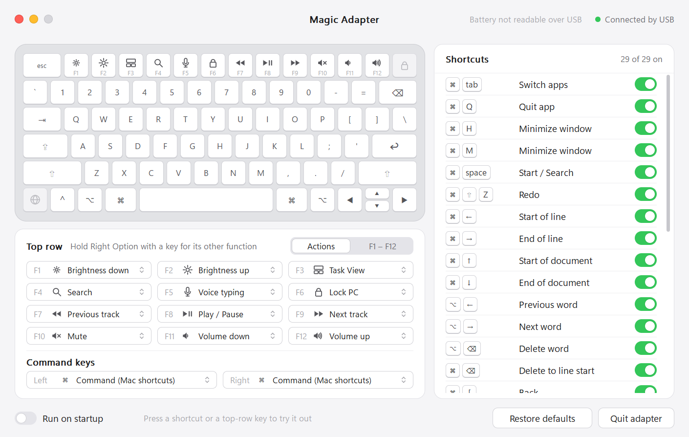

# Magic Adapter (keyboard enhancer for Windows)

Magic Adapter makes an Apple Magic Keyboard feel at home on Windows 11. It lets you keep using
Mac shortcuts such as Command+C and Command+Tab, and makes the top row work as brightness,
media and volume keys. It is one small program that sits quietly in the system tray.



## What it does

- **Mac shortcuts on Windows.** Command works like Ctrl, and the shortcuts that differ between
  the two systems (switching apps, quitting, jumping by word, screenshots and more) are translated.
- **A working top row.** Brightness, Task View, Search, voice typing, media and volume, as printed
  on the keys. Every key can be reassigned.
- **A live keyboard view.** Keys light up as you press them, and resting the mouse on a shortcut
  shows which keys it uses.
- **Light on your PC.** About 2 MB of memory while it runs in the tray. No installer, no
  background services, no drivers.

## Getting started

1. Download `MagicAdapter.exe` from the
   [latest release](https://github.com/JamesChu-byte337/magic-adapter/releases/latest).
   There is nothing to install.
2. Plug the Magic Keyboard in with its cable.
3. Run `MagicAdapter.exe`. The settings window opens and an icon appears in the system tray.
4. Close the window whenever you like. The app keeps running in the tray.

To go back to the normal Windows layout, quit the app (the **Quit adapter** button, or
right-click the tray icon and choose **Quit**).

> **Note:** the program is not code-signed. Windows SmartScreen may ask you to confirm before
> running it, and Windows 11's *Smart App Control* blocks unsigned programs entirely while it is
> switched on.

## Using the settings window

Click the tray icon to open it. Every change takes effect immediately.

- **Keyboard.** Click any top-row key or either Command key on the picture to change what it does.
- **Top row.** Choose whether the keys do their action or send F1 to F12, and pick an action for
  each key. Hold **Right Option** with a top-row key to get its other function.
- **Command keys.** Each Command key can act as Command (Mac shortcuts) or as the Windows key.
  Setting the right one to "Windows key" gives you Win+E, Win+D and the like.
- **Shortcuts.** Switch any shortcut off if you would rather keep the Windows behaviour.
- **Run on startup.** Starts Magic Adapter with Windows, straight to the tray.

## Shortcuts

Command works like Ctrl, so Command+C, V, X, Z, A, S, F, T, W and Command+click all work.
These are translated on top of that:

| Mac shortcut | What happens on Windows |
|---|---|
| Command+Tab | Switch apps |
| Command+Q | Quit app |
| Command+H, Command+M | Minimize window |
| Command+Space | Start / Search |
| Command+Shift+Z | Redo |
| Command+Left / Right | Start / end of line |
| Command+Up / Down | Start / end of document |
| Option+Left / Right | Jump by word |
| Option+Backspace | Delete word |
| Command+Backspace | Delete to line start (in File Explorer: move to Recycle Bin) |
| Command+[ / Command+] | Back / forward |
| Command+Shift+[ / ] | Previous / next tab |
| Command+Shift+3 | Screenshot saved to Pictures\Screenshots |
| Command+Shift+4 or 5 | Snipping tool |
| Control+Command+Q | Lock PC |
| Control+Command+F | Full screen |
| Control+Command+Space | Emoji picker |
| Command+Option+Esc | Task Manager |
| Control+Option+Arrows | Snap, maximize or restore the window |

Add Shift to the navigation shortcuts to select text.

## Top row (defaults)

| Key | Action |
|---|---|
| F1 / F2 | Screen brightness down / up |
| F3 | Task View |
| F4 | Search |
| F5 | Voice typing |
| F6 | Not assigned (sends F6) |
| F7 / F8 / F9 | Previous / Play-Pause / Next |
| F10 / F11 / F12 | Mute / Volume down / Volume up |

Other actions you can assign: Notifications, Show desktop, Snipping tool, Lock PC,
File Explorer and Settings.

## Good to know

- **Cable only for now.** Bluetooth is not supported yet.
- **Battery level is not shown.** Windows' built-in driver does not expose the keyboard's battery
  over USB, so the app says so instead of guessing.
- **The Fn/Globe key and the lock key do nothing.** Windows never receives them. Use Right Option
  for the F-keys and Control+Command+Q to lock.
- **Other keyboards are remapped too** while the Magic Keyboard is plugged in, because Windows
  cannot tell which keyboard a key came from. Unplug it and remapping pauses.
- **Windows running as administrator** (Task Manager, installers) do not see the remapping. If
  Ctrl seems stuck after using one, tap Command once.
- **Brightness keys** control the laptop's own screen, not external monitors.

## Building from source

You need [MSYS2](https://www.msys2.org/) with the UCRT64 g++ toolchain installed at `C:\msys64`.

```
powershell -ExecutionPolicy Bypass -File build.ps1
```

- `src/main.cpp`: the keyboard hook, shortcut table, tray icon and saved settings.
- `src/ui.inl`: the settings window. It is drawn entirely in code, including the keyboard and
  every icon, so there are no image files, UI frameworks or icon fonts.

Settings are stored in the registry under `HKCU\Software\MagicAdapter`.

## Disclaimer

Magic Adapter is an independent project. It is not affiliated with, endorsed by or sponsored by
Apple Inc. Apple, Mac and Magic Keyboard are trademarks of Apple Inc., and Windows is a trademark
of Microsoft Corporation; the names are used here only to say what the software works with. The
keyboard drawing and all icons in the app are original artwork; no Apple images or icon files are
included.
